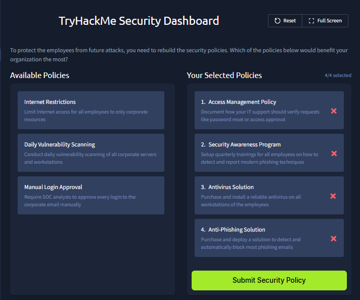

# Humans Attack Vectors

- **Platform:** TryHackMe
- **Difficulty:** Easy
- **Link:** [Humans Attack Vectors](https://tryhackme.com/room/humansattackvectors)

## Overview

This room explores how attackers target the weakest link in cyber security: humans. It covers social engineering tactics (phishing, malware downloads, deepfakes, impersonation), mitigation strategies, and ends with two hands-on challenges: investigating employee incidents and building a security policy.

## Task 1 - Introduction

The SOC does not just deal with technical threats, it also protects against attacks that target humans. This room looks at the methods of modern attackers and how they exploit human psychology.

Learning objectives:

- Learn the role of the human element in cyber security
- Understand the SOC role in detecting and mitigating attacks
- Practice the knowledge in two realistic scenarios

## Task 2 - The Human Element

A computer network is like a fortress with towering walls and armored gates. One way to conquer it is to breach the gates, but a much simpler way is to just ask the gatekeeper to open the door. In cyber security, humans are often these naive "gatekeepers", the weakest link.

Humans are targeted because of the **access** they can provide: websites, mailboxes, or databases. Some threat actors hunt for specific access, while others breach as many accounts as they can.

| Attack Example | Next Step of Attackers |
|----------------|----------------------|
| Breach Google account of the HR manager | Steal and sell the entire employee database |
| Trick a wealthy person into running malware | Hijack a web banking session from their PC |
| Breach the IT administrator's VPN account | Access the heart of a big corporate network |
| Trick a government worker into sharing secrets | Use the information to simplify the next attacks |

### Answers

| # | Question | Answer |
|---|----------|--------|
| 1 | What or who is the weakest link in cyber security? | `Humans` |
| 2 | What do attackers seek when targeting humans in a cyberattack? | `Access` |

## Task 3 - Attacks on Humans

Attacks targeting humans rely on **social engineering**, manipulating the victim into helping the attacker, whether knowingly or not. For the tactic to succeed, it must be:

- **Trustworthy**: the attacker must appear legitimate so the victim trusts them
- **Emotional**: the attack must trigger feelings like urgency, fear, or curiosity

### Phishing Attacks

The most common form of social engineering, with an estimated 3.4 billion malicious emails sent daily. Examples include fake login pages (such as a fake 1Password security alert) and emails with malware attachments (such as a fake tax penalty notice carrying a malicious .zip file).

### Malware Downloads

Threat actors trick users into downloading malware through fake websites (such as a fake Firefox update page that downloads a data stealer), malicious QR codes, fake CAPTCHAs that trick users into running commands, and SEO poisoning.

### Deepfakes

AI-generated video or audio used to impersonate family members, colleagues, or corporate partners. In one case, a finance worker received a deepfake video call from someone appearing to be their boss and wired $25 million.

### Impersonation

Pretending to be someone else. Many ransomware attacks started with attackers impersonating a corporate IT department and asking victims to hand over their accounts for a "system repair."

### Other Attacks

USB drop campaigns, physical attacks, insider threats, and fake job offers are all constant risks that a SOC analyst should be ready to respond to.

### Answers

| # | Question | Answer |
|---|----------|--------|
| 1 | What is the name of an attack tactic that manipulates human psychology? | `Social Engineering` |
| 2 | Which social engineering method is about pretending to be someone else? | `Impersonation` |

## Task 4 - Defending Humans

Defending against these threats involves two key tasks: **Mitigation** and **Detection**. Mitigation aims to prevent or reduce the chance and impact of attacks. No matter how good the mitigation measures are, they will eventually be bypassed, and that is where SOC skills become vital.

| Mitigation | Description |
|-----------|-------------|
| Anti-phishing solution | Blocks phishing emails before users even notice |
| Antivirus / EDR solution | Prevents humans from running malware on corporate hosts |
| "Trust but verify" principle | Instructs employees to detect deepfakes and verify suspicious requests |
| Security awareness training | Teaches employees to detect phishing through simulations |

### Answers

| # | Question | Answer |
|---|----------|--------|
| 1 | Which process is aimed at preventing or reducing the chance of an attack? | `Mitigation` |
| 2 | Which mitigation measure is about training employees in cyber security? | `Security Awareness Training` |

## Task 5 - Practice

The lab casts the player as a SOC analyst at TryHackMe. The security dashboard has two challenges: **Employees at Risk** and **Security Policy**.

### Employees at Risk

Four cases on the dashboard each call for the correct response:

1. **Lucas Martinez** (Software Engineer): downloaded "Setup.exe" from `best-freeapps-2025.top` while trying to install 7-Zip. The file was launched 6 times and blocked each time by antivirus. **Verdict**: quarantine the Setup.exe and instruct Lucas to use the official 7-Zip installer.

2. **Suspicious Email Attachment**: a SIEM alert for an email from `noreply@stripe-payments.xyz` to the Finance Director with an attached `Invoice.rar` (password-protected). **Verdict**: block the email and start the analysis. This is a phishing attempt.

3. **Isabella** (IT Support): received a phone call at 9 PM from a hidden number claiming to be the CEO, asking to reset Ben's Gmail password. Ben does not respond to messages. **Verdict**: disable Ben's Gmail account until he confirms the login or is back in the office.

4. **Anomalous Login**: Rose Lewis (HR Assistant) logged into Microsoft 365 from London instead of her usual Oxford location, and visited suspicious URLs including `login[.]micrsoft365-online[.]ru`. **Verdict**: disable Rose Lewis's account until the verdict is more certain.

### Security Policy

This challenge requires selecting the four most effective security policies for the organization:

The correct policies are:

1. **Access Management Policy**: document how IT support should verify requests like password resets
2. **Security Awareness Program**: set up quarterly trainings on detecting phishing
3. **Antivirus Solution**: install antivirus on all workstations
4. **Anti-Phishing Solution**: deploy a solution to block phishing emails

### Answers

| # | Question | Answer |
|---|----------|--------|
| 1 | What flag did you receive after completing the "Employees at Risk" challenge? | `THM{anyone_else_at_risk?}` |
| 2 | What flag did you receive after completing the "Security Policy" challenge? | `THM{human_protection_expert!}` |
