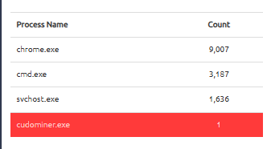
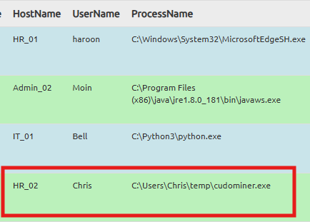
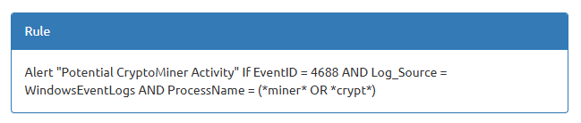

# Introduction to SIEM

- **Platform:** TryHackMe
- **Difficulty:** Easy
- **Link:** [Introduction to SIEM](https://tryhackme.com/room/introtosiem)

## Overview

This room introduces Security Information and Event Management (SIEM) systems: how different devices in a network generate logs and why a centralized solution is essential to collect, normalize, and correlate them. It covers log source types, SIEM features, detection rules, and the alerting process, and ends with a hands-on lab investigating a suspicious alert on a sample SIEM dashboard.

## Task 1 - Introduction

A Security Information and Event Management system (SIEM) is the core security solution a SOC analyst uses in the security operations center. This room explains how different devices in a network generate logs and why a centralized solution is essential to collect, normalize, and correlate them.

Learning objectives:

- Understand the different types of log sources
- Identify the limitations of working with isolated logs
- Recognize the importance of a SIEM solution
- Explore the features of a SIEM solution
- Learn the various types of log sources and their ingestion in the SIEM
- Understand the process behind alerting and alert analysis

### Answers

| # | Question | Answer |
|---|----------|--------|
| 1 | What does SIEM stand for? | `Security Information and Event Management system` |

## Task 2 - Logs Everywhere, Answers Nowhere

Multiple devices in a network communicate with each other and, most of the time, with the Internet through a router. These devices continuously generate logs of the activity that occurs within them. Log sources fall mainly into two categories.

### Host-Centric Log Sources

These log sources capture events that occurred within or related to the host. Devices that generate host-centric logs include Windows, Linux, servers, and similar. Some examples:

- A user accessing a file
- A user attempting to authenticate
- A process execution activity
- A process adding, editing, or deleting a registry key or value
- PowerShell execution

### Network-Centric Log Sources

Network-related logs are generated when hosts communicate with each other or access the internet. Devices that generate network-centric logs include firewalls, IDS/IPS, routers, and similar. Some examples:

- SSH connection
- A file being accessed via FTP
- Web traffic
- A user accessing the company's resources through VPN
- Network file sharing activity

### Challenges with Isolated Logs

- **Numerous Log Sources**: a network has many log sources generating hundreds of events per second, scattered across different devices
- **No Centralization**: logs reside on the machines where they are generated, requiring SSH, RDP, and similar to connect to each source
- **Limited Context**: individual logs cannot tell the whole story. Correlating logs from different sources reveals the full picture
- **Limited Analysis**: manually analyzing all logs from all devices is nearly impossible for humans
- **Format Issues**: different log sources generate logs in various formats, making analysis difficult

### Answers

| # | Question | Answer |
|---|----------|--------|
| 1 | Is Registry-related activity host-centric or network-centric? | `host-centric` |
| 2 | Is VPN-related activity host-centric or network-centric? | `network-centric` |

## Task 3 - Why SIEM?

Security Information and Event Management (SIEM) is a security solution that collects logs from various types of log sources, standardizes their format into a consistent one, correlates them, and detects malicious activity using detection rules.

The SIEM workflow follows four steps:

1. Collect data from sources
2. Aggregate data
3. Discover and detect threats
4. Identify breaches and investigate alerts

### Features of SIEM

- **Centralized Log Collection**: SIEM collects logs from all sources (endpoints, servers, firewalls, and so on) and centralizes them in one place using lightweight agents or APIs. This removes the need to jump onto every machine individually to analyze its logs.

- **Normalization of Logs**: raw logs come in different formats and sizes. SIEM breaks logs down into different fields and presents them in one consistent format. Breaking a log into fields is known as parsing, and converting all logs into one consistent format is known as normalization.

- **Correlation of Logs**: individual logs are not very useful on their own. SIEM correlates logs from different sources and finds relationships between them. For instance, a user logging in via VPN from a new IP, accessing shared documents, executing a PowerShell script, and making an outbound network connection may each look fine individually, but correlated together they could point to a data exfiltration attempt from compromised VPN credentials.

- **Real-time Alerting**: SIEM detects malicious activity based on detection rules. When the conditions are satisfied, alerts are triggered and analysts are notified to investigate.

- **Dashboards and Reporting**: dashboards present normalized and ingested data as actionable insights, including alert highlights, system notifications, health alerts, failed login attempts, events ingested count, rules triggered, and top domains visited.

### Answers

| # | Question | Answer |
|---|----------|--------|
| 1 | Read the task above. | No answer needed |

## Task 4 - Log Sources and Ingestion

### Windows Machine

Windows records every event, which can be viewed through the Event Viewer. It assigns a unique ID to each type of log activity, making it easy to examine and keep track of. These logs from all Windows endpoints are forwarded to the SIEM solution for monitoring and better visibility.

### Linux Machine

Linux stores all related logs such as events, errors, and warnings. Common locations include:

- `/var/log/httpd`: contains HTTP request/response and error logs
- `/var/log/cron`: events related to cron jobs
- `/var/log/auth.log` and `/var/log/secure`: authentication-related logs
- `/var/log/kern`: kernel-related events

### Web Server

Monitoring all requests and responses coming in and out of the web server is important for catching any web attack attempt. In Linux, common locations for Apache logs are `/var/log/apache` or `/var/log/httpd`.

### Log Ingestion

Each SIEM solution has its own way of ingesting logs. Common methods include:

1. **Agent / Forwarder**: a lightweight tool installed on the endpoint that captures and sends logs to the SIEM server
2. **Syslog**: a widely used protocol to collect data from various systems and send real-time data to a centralized destination
3. **Manual Upload**: some SIEM solutions allow ingesting offline data for quick analysis
4. **Port-Forwarding**: SIEM solutions can listen on a certain port, and endpoints forward data to it

### Answers

| # | Question | Answer |
|---|----------|--------|
| 1 | In which location within a Linux environment are HTTP logs stored? | `/var/log/httpd` |

## Task 5 - Alerting Process and Analysis

### Detection Rules

SIEM solutions use detection rules to catch threats. These rules are logical expressions that trigger alerts when the conditions are met. Examples include:

- If a user gets five failed login attempts in 10 seconds, raise an alert for `Multiple Failed Login Attempts`
- If a login is successful after multiple failed login attempts, raise an alert for `Successful Login After multiple Login Attempts`
- A rule set to alert every time a user plugs in a USB
- If outbound traffic is > 25 MB, raise an alert for a potential data exfiltration attempt

### Detection Rule Use Cases

**Use-Case 1**: adversaries tend to remove logs during post-exploitation. Event ID 104 is logged when a user tries to remove or clear event logs.

Rule: if Log Source is WinEventLog AND EventID is 104, trigger an alert `Event Log Cleared`

**Use-Case 2**: adversaries use commands like `whoami` after exploitation or privilege escalation.

Rule: if Log Source is WinEventLog AND EventCode is 4688 AND NewProcessName contains whoami, trigger an alert `WHOAMI command Execution DETECTED`

### Alert Investigation

When monitoring a SIEM, analysts spend most of their time on dashboards. Once an alert is triggered, the events/flows associated with it are examined, and the rule is checked to see which conditions were met. The analyst then determines whether it is a True or False Positive. Actions after analysis include:

- Alert is a False Positive: tune the rule to avoid similar false positives
- Alert is a True Positive: perform further investigation
- Contact the asset owner to inquire about the activity
- Suspicious activity confirmed: isolate the infected host
- Block the suspicious IP

### Answers

| # | Question | Answer |
|---|----------|--------|
| 1 | Which Event ID is generated when event logs are removed? | `104` |
| 2 | What type of alert may require tuning? | `False Positive` |

## Task 6 - Lab Work

The static lab displays a sample dashboard and events. When suspicious activity happens, an alert is triggered, meaning some events match the condition of a pre-configured detection rule.

After the Start Suspicious Activity button is clicked, the dashboard highlights a new process. Sorting by count reveals `cudominer.exe` with only one occurrence, which stands out as anomalous:

Drilling into the event details shows that user Chris on hostname HR_02 executed cudominer.exe from `C:\Users\Chris\temp\`:

Examining the detection rule confirms the match. The rule triggers on Event ID 4688 from Windows Event Logs when the process name contains "miner" or "crypt":

The activity is a True Positive: cudominer.exe is a cryptocurrency miner that should not be running on an HR workstation.

### Answers

| # | Question | Answer |
|---|----------|--------|
| 1 | After clicking on the Start Suspicious Activity button, which process caused the alert? | `cudominer.exe` |
| 2 | Find the event that caused the alert and identify the user responsible for the process execution. | `chris` |
| 3 | What is the hostname of the suspect user? | `HR_02` |
| 4 | Examine the rule and the suspicious process; which term matched the rule that caused the alert? | `miner` |
| 5 | Which option best represents the event? | `True Positive` |
| 6 | Selecting the right ACTION will display the FLAG. What is the FLAG? | `THM{000_SIEM_INTRO}` |
