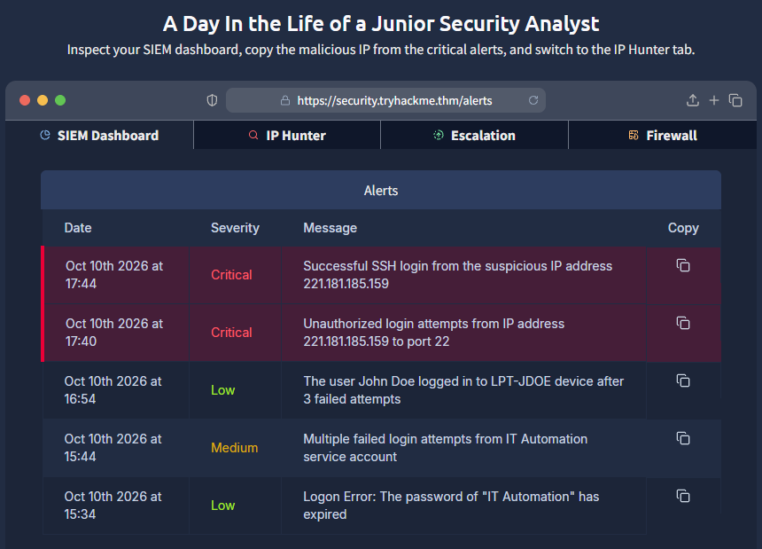
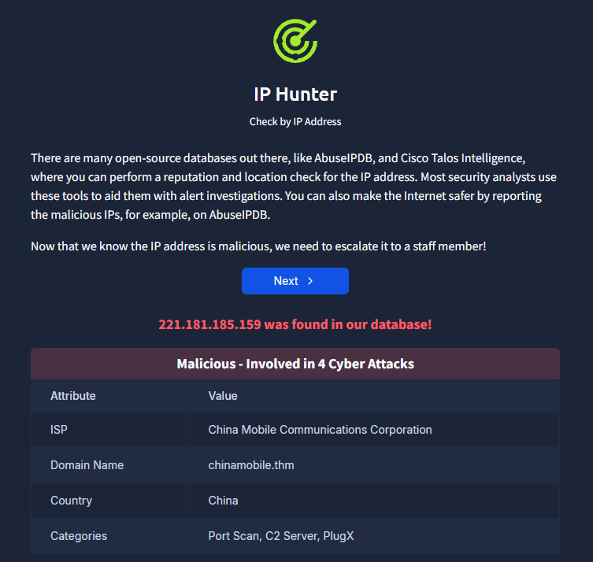
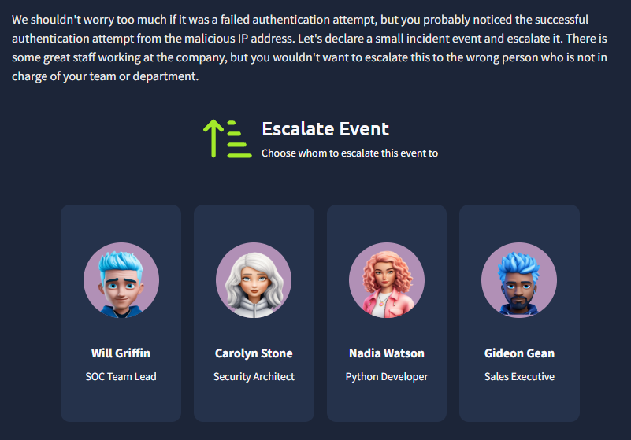
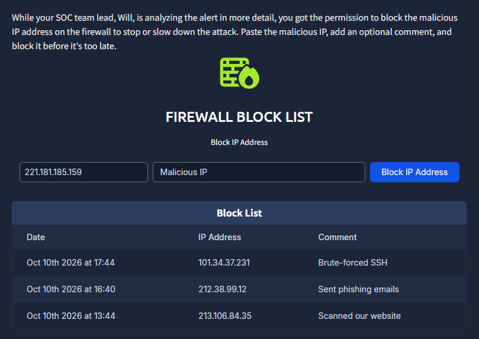

# Junior Security Analyst Intro

- **Platform:** TryHackMe
- **Difficulty:** Easy
- **Link:** [Junior Security Analyst Intro](https://tryhackme.com/room/jrsecanalystintrouxo)

## Overview

An introductory room to the SOC Level 1 path. It covers the role of a Junior Security Analyst, the structure of a Security Operations Center (SOC), and ends with a hands-on exercise: investigating alerts on a SIEM dashboard, looking up a suspicious IP, escalating the incident, and blocking the attacker on a firewall.

## Task 1 - Junior Security Analyst Journey

The first task introduces the role of a Junior Security Analyst, also called a SOC Level 1 Analyst. The role sits inside a 24/7 SOC team that reviews security alerts. The daily duties are:

- Monitor and investigate various security alerts
- Participate in SOC brainstorms and workshops
- Cooperate with other teams to keep the company safe
- Constantly learn and discover new attacks and defenses

### Answers

| # | Question | Answer |
|---|----------|--------|
| 1 | Which team do you work with as a Junior Security Analyst? | `SOC` |

## Task 2 - Security Operations Center (SOC)

This task introduces the SOC team and its different roles:

- **Will Griffin**, Senior Analyst: the closest colleague to a junior analyst, helps with escalations and handles complex cases after the initial analysis.
- **Corey Stevens**, SOC Engineer: maintains security tools and configures alerts, and does not analyze alerts directly.
- **Emily Conway**, SOC Manager: keeps everything under control and reports SOC results to top management.
- **Daniel Herrera**, Incident Responder: called on demand when something serious has happened, and handles major incidents.

The daily duties of a Junior Analyst may include:

- Detect and prevent a data stealer infection on a coworker's laptop
- Analyze and stop a phishing campaign targeting the finance team
- Participate in a bigger incident, such as a full-scale ransomware attack
- Team up with teammates to build detection rules and automations
- Go beyond cyber and understand how companies operate from the inside

## Task 3 - A Day in the Life of a Security Analyst

This is the hands-on task. The attached lab opens on a simulated alert dashboard.

### SIEM Dashboard

The SIEM dashboard shows several alerts. Two **Critical** alerts stand out at the top:

- **17:44**: Successful SSH login from the suspicious IP address `221.181.185.159`
- **17:40**: Unauthorized login attempts from IP address `221.181.185.159` to port 22

Other alerts of lower severity are also present (failed logins, expired passwords), but the critical ones demand immediate attention.

### IP Hunter

On the IP Hunter tab, a lookup of `221.181.185.159` returns a **malicious** verdict, with the IP tied to 4 cyber attacks:

| Attribute | Value |
|-----------|-------|
| ISP | China Mobile Communications Corporation |
| Domain Name | chinamobile.thm |
| Country | China |
| Categories | Port Scan, C2 Server, PlugX |

### Escalation

The IP is confirmed malicious and there was a successful SSH login, so the alert needs to be escalated. Among the available staff, **Will Griffin** (SOC Team Lead) is the correct person to escalate to, since he leads the team and handles complex cases.

### Firewall Block

After escalation, the malicious IP `221.181.185.159` is blocked on the firewall to stop the attack.

### Answers

| # | Question | Answer |
|---|----------|--------|
| 1 | What was the malicious IP address in the alerts? | `221.181.185.159` |
| 2 | To whom did you escalate the alert with the malicious IP? | `Will Griffin` |
| 3 | What message did you get after blocking the IP address on the firewall? | `THM{until-we-meet-again}` |
