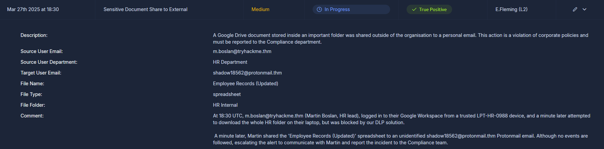
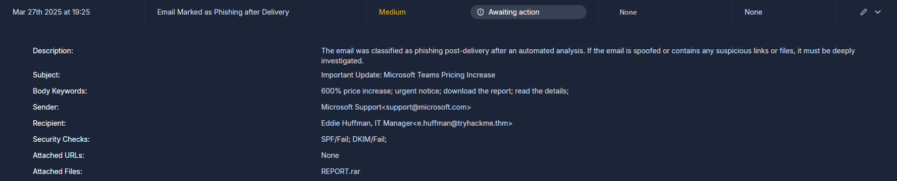
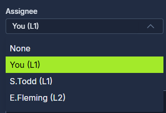
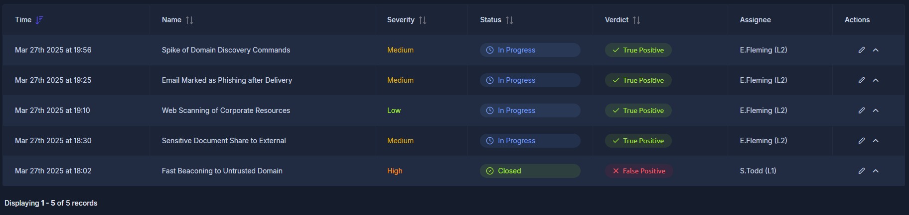

# SOC L1 Alert Reporting

- **Platform:** TryHackMe
- **Difficulty:** Easy
- **Link:** [SOC L1 Alert Reporting](https://tryhackme.com/room/socl1alertreporting)

## Overview

This room builds on alert triage by introducing three essential SOC skills: alert reporting, escalation, and communication. It covers how to write structured alert reports using the Five Ws approach, when and how to escalate alerts to L2 analysts, and how to handle crisis communication scenarios. The room includes hands-on practice on the SOC dashboard: investigating new alerts, writing reports, and escalating them.

## Task 1 - Introduction

After triaging alerts, L1 analysts may be uncertain about how to classify them and need senior support or information from the system owner. L1 analysts also deal with real cyberattacks and breaches that need immediate attention and remediation. This room covers these cases through three new terms: alert reporting, escalation, and communication.

Learning objectives:

- Understand the need for SOC alert reporting and escalation
- Learn how to write alert comments or case reports properly
- Explore escalation methods and communication best practices
- Apply the knowledge to triage alerts in a simulated environment
- Build confidence for the SOC Simulator and SAL1 certification

## Task 2 - Alert Funnel

The previous room covered how to classify and triage alerts. The next step is understanding what happens after triage: how does this work prevent threats and stop breaches?

L1 analysts receive alerts in a SIEM, EDR, or ticket management platform. Most alerts are closed as False Positives or handled at L1 level, but complex and threatening ones are sent to L2. Out of 100 SIEM alerts, roughly 10 make it through as True Positives to L2, and from those, maybe 1 becomes an incident handled by the DFIR team. The ultimate goal is to protect corporate data.

Sending alerts further requires three skills.

### Alert Reporting

Before closing or passing an alert to L2, it may need to be reported. Depending on team standards and alert severity, the investigation may have to be documented in detail, ensuring all relevant evidence is included. This is especially important for True Positives, which require escalation.

### Alert Escalation

If a True Positive alert requires additional actions or deeper investigation, it is escalated to the L2 analyst for further review following the agreed procedures. The alert report comes in handy here, since L2 uses it to get the initial context and spend less time analysing from scratch.

### Communication

Communication with other departments is often needed during or after the analysis. For example, asking the IT team to confirm administrative privileges granted to some users, or contacting HR for more information about a newly hired employee.

### Answers

| # | Question | Answer |
|---|----------|--------|
| 1 | What is the process of passing suspicious alerts to an L2 analyst for review? | `Alert Escalation` |
| 2 | What is the process of formally describing alert details and findings? | `Alert Reporting` |

## Task 3 - Reporting Guide

Having L1 analysts write alert reports in addition to marking alerts as True or False Positives is essential. Alert reports serve several key purposes:

| Alert Report Purpose | Explanation |
|---------------------|-------------|
| Provide context for escalation | A well-written report saves lots of time for L2 analysts and helps them quickly understand what happened |
| Save findings for the records | Raw SIEM logs are stored for 3-12 months, but alerts are kept indefinitely. Keeping all the context inside the alert is safer, just in case |
| Improve investigation skills | If something cannot be explained simply, it is not understood well enough. Report writing is a great way to boost L1 skills by summarising alerts |

### Report Format

A good report is written for an L2 analyst, a DFIR team member, or an IT professional who needs to understand the alert. The **Five Ws** approach covers at least these items:

- **Who**: which user logs in, runs the command, or downloads the file
- **What**: the exact action or event sequence performed
- **When**: when exactly the suspicious activity started and ended
- **Where**: which device, IP, or website was involved in the alert
- **Why**: the most important W, the reasoning behind the final verdict

On the SOC dashboard, the "Sensitive Document Share to External" alert reveals that m.boslan@tryhackme.thm shared an internal HR spreadsheet ("Employee Records (Updated)") to an external Protonmail address. The DLP solution had already blocked an attempt to download the whole HR folder:

A new "Email Marked as Phishing after Delivery" alert also appears, showing an email from support@microsoft.com to the IT Manager with a suspicious REPORT.rar attachment. Both SPF and DKIM checks failed:

Investigating the phishing alert and writing a proper report using the Five Ws template reveals the flag.

### Answers

| # | Question | Answer |
|---|----------|--------|
| 1 | According to the SOC dashboard, which user email leaked the sensitive document? | `m.boslan@tryhackme.thm` |
| 2 | Looking at the new alerts, who is the "sender" of the suspicious, likely phishing email? | `support@microsoft.com` |
| 3 | Using the Five Ws template, what flag did you receive after writing a good report? | `THM{nice_attempt_faking_microsoft_support}` |

## Task 4 - Escalation Guide

After making a verdict and writing the alert report, the next decision is whether to escalate the alert to L2. Escalation is appropriate when:

1. The alert is an indicator of a major cyberattack requiring deeper investigation or DFIR
2. Remediation actions like malware removal, host isolation, or password reset are required
3. Communication with customers, partners, management, or law enforcement is required
4. The alert is simply not fully understood and needs help from more senior analysts

### Escalation Steps

To escalate an alert, reassign it to the L2 on shift and ping them in corporate chat or in person. Some teams also require a formal written escalation request with dozens of required fields.

### Requesting L2 Support

It is generally fine for L1 to request senior support when something is unclear. Especially in the first months, it is always better to discuss the alert and clarify SOC procedures than to blindly close an alert that is not understood.

### SOC Dashboard Escalation

On the dashboard, the escalation workflow is:

1. Move the alert to **In Progress** status and do the analysis
2. Write an alert report and set the **verdict**, such as True Positive
3. If escalation is required, assign the alert **to the L2** on shift
4. L2 receives a notification and starts from the alert report

The assignee dropdown shows the available team members, with E.Fleming as the L2 analyst on shift:

After both new alerts are correctly escalated to L2, the dashboard shows all alerts processed:

### Answers

| # | Question | Answer |
|---|----------|--------|
| 1 | Who is your current L2 in the SOC dashboard that you can assign (escalate) the alerts to? | `E.Fleming` |
| 2 | What flag did you receive after correctly escalating the alert from the previous task to L2? | `THM{good_job_escalating_your_first_alert}` |
| 3 | What flag did you get after escalating the second new alert according to the workflow? | `THM{looks_like_webshell_via_old_exchange}` |

## Task 5 - SOC Communication

Escalation and reporting are straightforward in most cases, but unexpected and critical situations also come up. The SOC team has its own **Crisis Communication** procedures, with guides and processes to help the whole team resolve issues.

### Communication Cases

- **L2 is unavailable for 30 minutes during a critical alert**: first try to call L2, then L3, and finally the manager. Knowing where to find emergency contacts is essential.
- **Account compromise requires validating the login with the affected user**: do not contact the user through the breached chat. Use an alternative method like a phone call.
- **Overwhelming number of alerts, some critical**: prioritise alerts according to the workflow, but inform the L2 on shift about the situation.
- **An alert was misclassified and a malicious action was likely missed**: immediately reach out to L2 with the concern. Threat actors can stay silent for weeks before impact.
- **SIEM logs are not parsed correctly or not searchable**: do not skip the alert. Investigate what is possible and report the issue to the L2 on shift or a SOC engineer.

### Communication By L2

No matter what the agreements are, L2 eventually receives the ticket, reads the report, and reaches back out with any questions. Once everything is clear, the L2 analyst typically researches the alert details further, validates whether the alert is indeed a True Positive, communicates with other departments if needed, and for major incidents, starts a formal Incident Response process.

### Answers

| # | Question | Answer |
|---|----------|--------|
| 1 | Should you first try to contact your manager in case of a critical threat (Yea/Nay)? | `Nay` |
| 2 | Should you immediately contact your L2 if you think you missed the attack (Yea/Nay)? | `Yea` |
