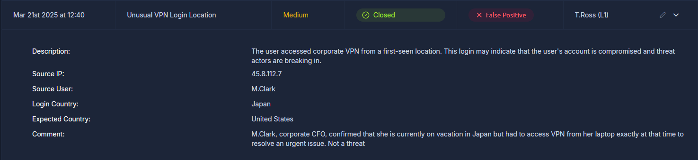
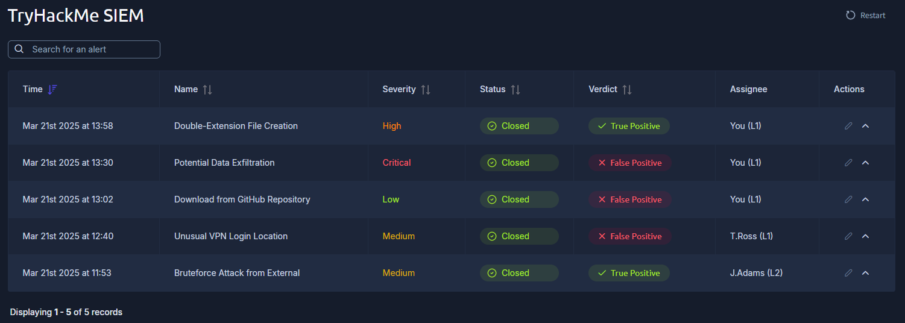

# SOC L1 Alert Triage

- **Platform:** TryHackMe
- **Difficulty:** Easy
- **Link:** [SOC L1 Alert Triage](https://tryhackme.com/room/socl1alerttriage)

## Overview

This room covers the full lifecycle of SOC alerts, from event generation to correct resolution. It explains what alerts are, how they are structured, how to prioritise them, and how an L1 analyst performs alert triage. The room includes a hands-on SIEM dashboard with three alerts to triage.

## Task 1 - Introduction

An alert is a core concept for any SOC team. Handling it properly ultimately decides whether a security breach is detected and prevented, or missed and devastating. This room is essential for SOC L1 analysts to understand alerts from event generation to correct resolution.

Learning objectives:

- Get familiar with the concept of a SOC alert
- Explore alert fields, statuses, and classification
- Learn how to perform alert triage as an L1 analyst
- Practice with real alerts and SOC workflows
- Prepare for the SOC Simulator and SAL1 certification

## Task 2 - Events and Alerts

### From Events to Alerts

The flow from event to alert works like this: first, an event occurs (user login, process launch, file download). The system (OS, firewall, cloud provider) logs it. Then all logs are shipped to a security solution like a SIEM or EDR. A SOC team can receive millions of logs per day, but most events are expected. An **alert** is a notification generated by the security solution when a specific event or sequence of events occurs, highlighting only suspicious, anomalous activity. This saves analysts from reviewing millions of raw logs manually.

### Alert Management Platforms

| Solution | Examples | Description |
|----------|----------|-------------|
| SIEM System | Splunk ES, Elastic | Solid alert management capabilities, a perfect choice for most SOC teams |
| EDR or NDR | MS Defender, CrowdStrike | Provide their own alert dashboards, but SIEM or SOAR is preferred |
| SOAR System | Splunk SOAR, Cortex SOAR | Bigger SOC teams can use SOAR to aggregate and centralise alerts from multiple solutions |
| ITSM System | Jira, TheHive | Custom ticket management setup using a dedicated solution |

### L1 Role in Alert Triage

SOC L1 analysts are the first line of defence and work with alerts the most. Everyone in the SOC team is involved in alert triage:

- **SOC L1 analysts**: review the alerts, distinguish bad from good, and notify L2 analysts in case of a real threat
- **SOC L2 analysts**: receive the alerts escalated by L1 analysts and perform deeper analysis and remediation
- **SOC engineers**: ensure the alerts contain enough information for efficient alert triage
- **SOC manager**: tracks the speed and quality of alert triage to ensure that real attacks are not missed

### Answers

| # | Question | Answer |
|---|----------|--------|
| 1 | What is the number of alerts you see in the SOC dashboard? | `5` |
| 2 | What is the name of the most recent alert you see? | `Double-Extension File Creation` |

## Task 3 - Alert Properties

Alerts generally have a few main properties worth understanding before taking action. The eight key properties are:

| # | Property | Description |
|---|----------|-------------|
| 1 | Alert Time | Creation time. The alert usually triggers a few minutes after the actual event |
| 2 | Alert Name | Summary of what happened, based on the detection rule's name |
| 3 | Alert Severity | Urgency level: Low/Informational, Medium/Moderate, High/Severe, Critical/Urgent |
| 4 | Alert Status | Whether someone is working on it: New/Unassigned, In Progress/Pending, Closed/Resolved |
| 5 | Alert Verdict | Classification: True Positive (real threat) or False Positive (no threat) |
| 6 | Alert Assignee | The analyst assigned or self-assigned to review the alert |
| 7 | Alert Description | Logic of the detection rule, why the activity can indicate an attack, and optionally how to triage |
| 8 | Alert Fields | SOC analysts' comments and the values that triggered the alert (hostname, commandline, etc.) |

The "Unusual VPN Login Location" alert is a good example. It triggered because user M.Clark accessed the corporate VPN from Japan instead of the expected United States. The comment reveals that M.Clark, corporate CFO, confirmed she was on vacation in Japan and had to access the VPN to resolve an urgent issue. The verdict was correctly marked as **False Positive**.

### Answers

| # | Question | Answer |
|---|----------|--------|
| 1 | What was the verdict for the "Unusual VPN Login Location" alert? | `False Positive` |
| 2 | What user was mentioned in the "Unusual VPN Login Location" alert? | `M.Clark` |

## Task 4 - Alert Prioritisation

With hundreds of alerts in the queue, the first decision is which to pick up first. This process is called **Alert Prioritisation**. The most commonly used approach has three steps:

1. **Filter the alerts**: only take new, unseen, and unresolved alerts. Leave alerts that other analysts have already reviewed or are investigating.
2. **Sort by severity**: start with critical alerts, then high, medium, and finally low. Critical alerts are designed to be more likely real, major threats with much more impact.
3. **Sort by time**: start with the oldest alerts and end with the newest. If both alerts are about breaches, the attacker from the older breach is likely already dumping data, while the newer one has just started.

Applying these rules to the dashboard, the first-priority alert is **Potential Data Exfiltration**: it carries Critical severity and is the oldest unresolved alert at that severity level.

### Answers

| # | Question | Answer |
|---|----------|--------|
| 1 | Should you first prioritise medium over low severity alerts (Yea/Nay)? | `Yea` |
| 2 | Should you first take the newest alerts and then the older ones (Yea/Nay)? | `Nay` |
| 3 | Assign yourself to the first-priority alert. What is the name of your selected alert? | `Potential Data Exfiltration` |

## Task 5 - Alert Triage

The alert triage process follows a structured flow:

1. **Initial Actions**: take ownership of the alert, move it to **In Progress**, and get familiar with its name, description, and key indicators.
2. **Investigation**: apply technical knowledge to understand the activity. Check whether workbooks (playbooks/runbooks) exist for this alert category. If not:
   - Determine who is under threat (user, hostname, cloud, network, website)
   - Note the action described (suspicious login, malware, phishing)
   - Review surrounding events shortly after or before the alert
   - Use threat intelligence platforms to verify the analysis
3. **Final Actions**: decide whether the alert is a True Positive or False Positive, prepare a detailed comment explaining the analysis, and move the alert to **Closed**. Escalate to L2 if necessary.

After triaging all three alerts in priority order (Potential Data Exfiltration, Double-Extension File Creation, Download from GitHub Repository), the final dashboard shows all alerts closed:

### Answers

| # | Question | Answer |
|---|----------|--------|
| 1 | Which flag did you receive after you correctly triaged the first-priority alert? | `THM{looks_like_lots_of_zoom_meetings}` |
| 2 | Which flag did you receive after you correctly triaged the second-priority alert? | `THM{how_could_this_user_fall_for_it?}` |
| 3 | Which flag did you receive after you correctly triaged the third-priority alert? | `THM{should_we_allow_github_for_devs?}` |
