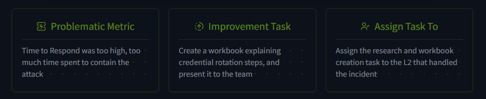
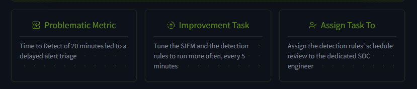
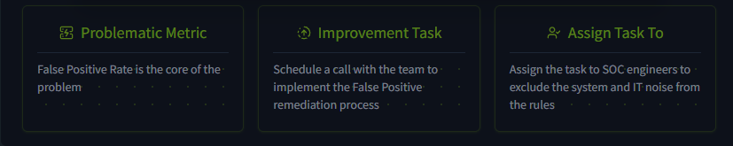

# SOC Metrics & Objectives

- **Platform:** TryHackMe
- **Difficulty:** Easy
- **Link:** [SOC Metrics & Objectives](https://tryhackme.com/room/socmetricsobjectives)

## Overview

This room explores how the efficiency of a SOC team is measured using indicators and metrics. It covers the most common evaluation approaches like MTTD and MTTR, describes methods to improve the metrics, and highlights the potential consequences of ignoring them. The room ends with a hands-on exercise where you act as a SOC manager and assign improvement tasks across three scenarios.

## Task 1 - Introduction

As with any other department, the efficiency of the SOC team can be measured using different indicators and metrics. This room explores the most common evaluation approaches like MTTD and MTTR and describes both methods to improve the metrics and potential consequences of ignoring them.

Learning objectives:

- Discover the concepts of SLA, MTTD, MTTA, and MTTR
- Understand the importance of the False Positive rate
- Learn why and how to improve the metrics as an L1 analyst
- Practice with managing SOC team performance metrics

## Task 2 - Core Metrics

The main goal of a SOC is to protect the confidentiality, integrity, and availability of the organisation's digital assets. The L1 analysts' role in this process is to reliably report True Positives to L2. This leads to four core metrics:

| Metric | Formula | Measures |
|--------|---------|----------|
| Alerts Count | AC = Total Count of Alerts Received | Overall load of SOC analysts |
| False Positive Rate | FPR = False Positives / Total Alerts | Level of noise in the alerts |
| Alert Escalation Rate | AER = Escalated Alerts / Total Alerts | Experience of L1 analysts |
| Threat Detection Rate | TDR = Detected Threats / Total Threats | Reliability of the SOC team |

### Alerts Count

Imagine starting your shift and seeing 80 unresolved alerts in the queue. That's definitely overwhelming and prone to missing real threats hiding behind the noise spam. On the other hand, consider a whole week without any alerts. Sounds better at first glance, but also concerning since a too low count of alerts may indicate an issue in the SIEM or lack of visibility, leading to undetected breaches. The ideal value depends on company size but in general, **5 to 30 alerts per day per L1 analyst** is a good metric.

### False Positive Rate

If 75 out of 80 alerts (94%) were confirmed to be False Positives like system noise or typical IT activity, that's a bad signal for your team. With more noise, analysts tend to become less vigilant and more likely to miss the threat and treat all alerts just like "yet another spam". A False Positive rate of **0% is an unachievable ideal, but 80% or higher is a serious problem**, usually fixed by a tool and detection rules tuning, often called "False Positive Remediation".

### Alert Escalation Rate

L2 analysts rely on L1 to filter out the noise and escalate only the actionable, threatening alerts. At the same time, as L1, you don't want to be overconfident and triage alerts you do not fully understand without a senior support. The alert escalation rate comes in handy to evaluate how experienced and independent the L1 analysts are and how often they decide to escalate the alert. It is usually **aimed to be below 50%, or even better below 20%**.

### Threat Detection Rate

Imagine that out of six attacks for 2025, your SOC team detected and prevented four attacks, missed the fifth because of the broken detection rule, and the sixth because one of the L1 analysts misclassified the breach as False Positive. The resulting metric is TDR = 4 / 6 = 67%, and this is a very bad result. The threat detection rate **should always be at 100%** since every missed threat can have devastating consequences, such as ransomware infection and data exfiltration.

### Answers

| # | Question | Answer |
|---|----------|--------|
| 1 | Is zero alerts for one month a good sign for your SOC team? (Yea/Nay) | `Nay` |
| 2 | What is the False Positive Rate if only 10 out of 50 alerts appear to be real threats? | `80%` |

## Task 3 - Triage Metrics

An alert by itself will not stop the breach. It is important to timely receive the alert, triage it, and respond to the attack before the attackers achieve their goals. The requirements to ensure a quick detection and remediation of the threat are commonly grouped into a **Service Level Agreement (SLA)**, a document signed between the internal SOC team and its company management, or by the managed SOC provider (MSSP) and its customers.

The agreement usually requires quick threat detection (measured by **MTTD**), timely alert acknowledgement by L1 analysts (measured by **MTTA**), and finally, prompt response to the threat, like isolating the device or securing the breached account (measured by **MTTR**).

The timeline flows as follows: a malicious event occurs, then the SOC receives a SIEM or EDR alert (MTTD), then an L1 analyst starts the alert triage (MTTA), followed by escalation and other workflows (Internal Processes), until the SOC fully mitigates the breach (MTTR covers from alert reception to full mitigation).

### Reference Table

| Metric | Common SLA | Description |
|--------|-----------|-------------|
| SOC Team Availability | 24/7 | Working schedule of the SOC team, often Monday-Friday (8/5) or 24/7 mode |
| Mean Time to Detect (MTTD) | 5 minutes | Average time between the attack and its detection by SOC tools |
| Mean Time to Acknowledge (MTTA) | 10 minutes | Average time for L1 analysts to start triage of the new alert |
| Mean Time to Respond (MTTR) | 60 minutes | Average time taken by SOC to actually stop the breach from spreading |

### Answers

| # | Question | Answer |
|---|----------|--------|
| 1 | Imagine a scenario where the SOC team receives a critical alert on Saturday. If the team works 8/5, on which day of the week will they acknowledge the alert? | `Monday` |
| 2 | Scenario: SOC received the "Connection to Redline Stealer C2" alert after 12 minutes, L1 moved to In Progress 10 minutes later, after 6 minutes it was escalated to L2, who spent 35 minutes cleaning the malware. Provide the MTTD, MTTA, and MTTR via comma. | `12,10,51` |

## Task 4 - Improving Metrics

Now that you know a lot about different metrics, why would it matter to you as an L1 analyst? First, metrics were built to make the SOC more efficient and therefore to make the attacks far less successful. Second, the metrics are often used to evaluate your performance, and good results lead to career growth and a raise to more senior positions like L2 analyst.

### Reference Table

| Issue | Recommendations |
|-------|----------------|
| False Positive Rate over 80% | Your team receives too much noise in the alerts. Try to: 1. Exclude trusted activities like system updates from your EDR or SIEM detection rules. 2. Consider automating alert triage for most common alerts using SOAR or custom scripts |
| Mean Time to Detect over 30 min | Your team detects a threat with a high delay. Try to: 1. Contact SOC engineers to make the detection rules run faster or with a higher rate. 2. Check if SIEM logs are collected in real-time, without a 10-minute delay |
| Mean Time to Acknowledge over 30 min | L1 analysts start alert triage with a high delay. Try to: 1. Ensure the analysts are notified in real-time when a new alert appears. 2. Try to evenly distribute alerts in the queue between the analysts on shift |
| Mean Time to Respond over 4 hours | SOC team can't stop the breach in time. Try to: 1. As L1, make everything possible to quickly escalate the threats to L2. 2. Ensure your team has documented what to do during different attack scenarios |

### Answers

| # | Question | Answer |
|---|----------|--------|
| 1 | What is the highest acceptable False Positive Rate for SOC teams? | `80%` |
| 2 | Should all SOC roles work together to keep metrics improving? (Yea/Nay) | `Yea` |

## Task 5 - Practice Scenarios

While metrics tracking is usually the SOC manager's job, a technical person is always required to propose improvements or highlight the issues. As a SOC L1 analyst, you are the first to notice excessive alert numbers or a high False Positive rate, so make sure you know how to communicate the issue and what to do to fix it.

In this lab, you imagine yourself as a SOC manager receiving different complaints related to the SOC team. You improve SOC metrics across three scenarios by correctly assigning improvement tasks from the list. The main complaint comes from a customer (OpenDoor Inc.) whose CFO's email and Entra ID account were breached. It took the team almost 6 hours to kick out the hacker, and threat actors had enough time to dump all emails and leak them on the Darknet. Looking at the report, the team had a critical alert and spent 5 hours trying to properly reset the victim's Entra ID password and MFA.

### Scenario 1: Slow Response Time

- **Problematic Metric**: Time to Respond was too high, too much time spent to contain the attack
- **Improvement Task**: Create a workbook explaining credential rotation steps, and present it to the team
- **Assign Task To**: Assign the research and workbook creation task to the L2 that handled the incident

### Scenario 2: Delayed Detection

- **Problematic Metric**: Time to Detect of 20 minutes led to a delayed alert triage
- **Improvement Task**: Tune the SIEM and the detection rules to run more often, every 5 minutes
- **Assign Task To**: Assign the detection rules' schedule review to the dedicated SOC engineer

### Scenario 3: High False Positive Rate

- **Problematic Metric**: False Positive Rate is the core of the problem
- **Improvement Task**: Schedule a call with the team to implement the False Positive remediation process
- **Assign Task To**: Assign the task to SOC engineers to exclude the system and IT noise from the rules

### Answers

| # | Question | Answer |
|---|----------|--------|
| 1 | What flag did you get after completing the first scenario? | `THM{mttr:quick_start_but_slow_response}` |
| 2 | What flag did you get after completing the second scenario? | `THM{mttd:time_between_attack_and_alert}` |
| 3 | What flag did you get after completing the third scenario? | `THM{fpr:the_main_cause_of_l1_burnout}` |
