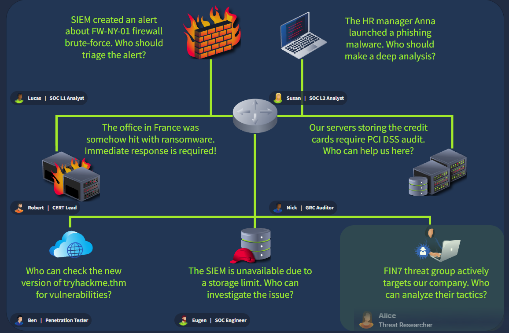

# SOC Role in Blue Team

- **Platform:** TryHackMe
- **Difficulty:** Easy
- **Link:** [SOC Role in Blue Team](https://tryhackme.com/room/socroleinblueteam)

## Overview

This room goes deeper into the Blue Team's place within a company's security structure. It covers the security hierarchy, the different departments (SOC, CIRT, specialized roles), career progression for a SOC L1 analyst, and ends with a drag-and-drop challenge that assigns the right people to security incidents.

## Task 1 - Introduction

A brief introduction building on the Junior Security Analyst Intro room. The learning objectives are:

- Understand the concept and purpose of the Blue Team
- Explore the SOC's place within a company structure
- Learn about the career path of a SOC L1 analyst

## Task 2 - Security Hierarchy

Every company has a unique security structure. At a high level, the hierarchy looks like this:

1. **Executives** (CEO / CFO / Company owner): focus on global business objectives
2. **Security Leadership** (CTO / CIO / CISO): lead company-wide IT or security programs
3. **Security Managers** (Team Lead / SOC Manager): manage a single team or department like the SOC
4. **Technical** (Analyst / Engineer / Red Teamer): perform technical tasks like log analysis

Top executives focus on business objectives and do not manage technical aspects, which is why they hire a **CISO** (Chief Information Security Officer) to create the most suitable security departments.

In bigger companies, the CISO oversees multiple security teams:

- **Red Team**: offensive security experts, pentesters, or ethical hackers who look for security issues
- **GRC Team**: specialists managing policies and ensuring compliance with regulations like PCI DSS
- **Blue Team**: defensive security experts like SOC analysts, engineers, or incident responders

### Answers

| # | Question | Answer |
|---|----------|--------|
| 1 | Which senior role typically makes key cyber security decisions? | `CISO` |
| 2 | What is the common name for roles like SOC analysts and engineers? | `Blue Team` |

## Task 3 - Meet the Blue Team

The Blue Team focuses on defensive security, constantly monitoring for attacks and responding quickly. It can include 3 to 50 members depending on the company. The most common Blue Team departments are the following.

### Security Operations Center (SOC)

The SOC is the first line of defense. It operates 24/7, creates detection rules, investigates security alerts, collects and monitors logs, cooperates with the IT team, and writes summary reports. Its roles include:

- **L1 Analysts**: junior members who triage alerts and pass complex cases to L2
- **L2 Analysts**: experienced members who investigate more advanced attacks
- **Engineers**: experts in configuring security tools like EDR or SIEM
- **Manager**: manages the whole SOC team

### Cyber Incident Response Team (CIRT)

Also called CSIRT or CERT, these are the "cyber firefighters" called on demand when an incident goes out of control. They support the SOC with analysis, handle critical incidents, identify hidden threats, perform deep forensics, and recover breached systems. Roles include CSIRT Manager, Forensics Lead, Threat Intel Expert, Threat Hunting Expert, and Malware Analyst.

Real-world CIRT examples: JPCERT (Japan), Mandiant, AWS CIRT.

### Specialized Defensive Roles

Large companies may require narrow, specialized Blue Team roles:

- **Digital Forensics Analyst**: uncovers hidden threats in disk and memory
- **Threat Intelligence Analyst**: gathers data about emerging threat groups
- **AppSec Engineer**: maintains a secure software development lifecycle
- **AI Researcher**: studies AI threats and how to defend against them

### Answers

| # | Question | Answer |
|---|----------|--------|
| 1 | Does Blue Team focus on defensive or offensive security? | `Defensive` |
| 2 | Which department handles active or urgent cyber incidents? | `CIRT` |

## Task 4 - Advancing SOC Career

Starting as a SOC L1 analyst is a great way to broaden cyber awareness. The steps to get started are:

1. Gain core SOC skills and practice them (red teaming or general IT helps too)
2. Stay proactive: try CTFs, keep up with cyber news, consider the SAL1 certification
3. Prepare for interviews, learn the difference between internal SOC and MSSP, and apply
4. After time in a junior position, prepare and advance to more senior roles

### Internal SOC vs MSSP

| Topic | Internal SOC | MSSP |
|-------|-------------|------|
| Scenario Example | SOC team of a bank protecting the bank's systems | Global MSSP protecting sixty customers in Europe |
| Working Pace | Calm shifts without too much time pressure | Shift starts from a queue of urgent alerts |
| Security Tools | Few tools, but need to know them very well | Sixty diverse security tools and platforms |
| Incident Practice | Two major cyber attacks last year | Attacks and breaches to deal with every week |

The natural next step after L1 is to become a **SOC L2 Analyst**, though branching into engineering, incident response, or management is also possible.

### Answers

| # | Question | Answer |
|---|----------|--------|
| 1 | How would you call a cyber security company providing SOC services? | `MSSP` |
| 2 | Which role naturally continues your SOC L1 analyst journey? | `SOC L2 Analyst` |

## Task 5 - Final Challenge

The final challenge casts the player as the CISO of TrySecureMe, a big multinational company. Seven incidents happen at once, and the right roles must be dragged and dropped to handle each one.

The correct assignments are:

| Incident | Assigned Role |
|----------|--------------|
| SIEM alert about FW-NY-01 firewall brute-force. Who should triage? | Lucas - SOC L1 Analyst |
| HR manager Anna launched a phishing malware. Who should make a deep analysis? | Susan - SOC L2 Analyst |
| Ransomware hit the office in France. Immediate response required | Robert - CERT Lead |
| Credit card servers require PCI DSS audit | Nick - GRC Auditor |
| Check tryhackme.thm for vulnerabilities | Ben - Penetration Tester |
| SIEM unavailable due to storage limit. Who can investigate? | Eugen - SOC Engineer |
| FIN7 threat group actively targets the company. Who can analyze their tactics? | Alice - Threat Researcher |

### Answers

| # | Question | Answer |
|---|----------|--------|
| 1 | What flag did you claim after completing the final challenge? | `THM{trysecureme_is_secured!}` |
