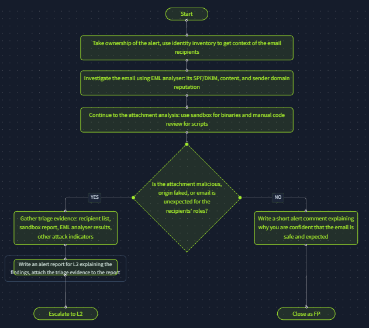
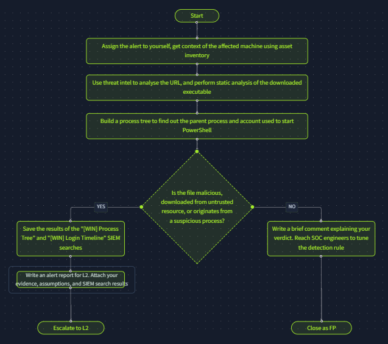
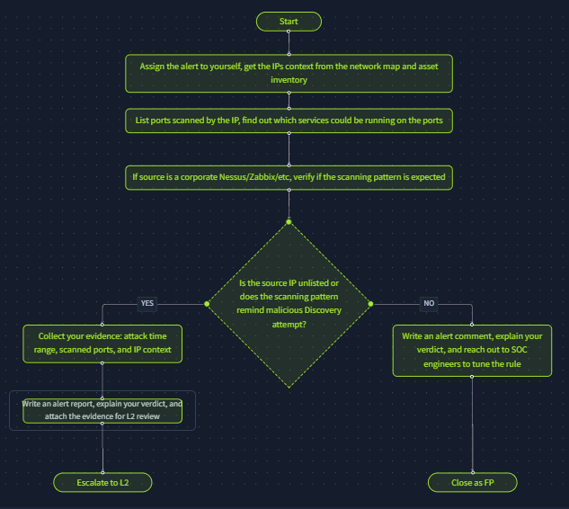

# SOC Workbooks & Lookups

- **Platform:** TryHackMe
- **Difficulty:** Easy
- **Link:** [SOC Workbooks & Lookups](https://tryhackme.com/room/socworkbookslookups)

## Overview

This room explores SOC workbooks designed to streamline alert triage and the various lookup methods used to quickly retrieve user and system context. It covers identity inventory, asset inventory, and network diagrams as key sources of information during an investigation, then workbook theory (enrichment, investigation, and escalation stages), and ends with a hands-on exercise building three investigation workbooks.

## Task 1 - Introduction

Alert triage is a complex process that often requires gathering additional information about affected employees or servers. This room explores SOC workbooks designed to streamline alert triage and the lookup methods used to quickly retrieve user and system context.

Learning objectives:

- Get familiar with SOC investigation workbooks
- Learn where to find and how to use asset inventory in a SOC
- Understand the importance of corporate network diagrams
- Practice workflow building inside an interactive interface

## Task 2 - Assets & Identities

Consider a night shift alert stating that G.Baker logged into the HQ-FINFS-02 server, downloaded the "Financial Report US 2024.xlsx" file, and shared it with R.Lund. Triaging this alert correctly requires answers to several questions: Who is G.Baker? What is HQ-FINFS-02? Why would R.Lund need access to corporate financial records?

### Identity Inventory

Identity inventory is a catalogue of corporate employees (user accounts), services (machine accounts), and their details like privileges, contacts, and roles within the company. For the scenario above, identity inventory provides context about G.Baker and R.Lund, and makes it simpler to decide whether the activity was expected.

| Full Name | Username | Email | Role | Location | Access |
|-----------|----------|-------|------|----------|--------|
| Gregory Baker | G.Baker | g.baker@tryhatme.thm | Chief Financial Officer | Europe, UK | VPN, HQ, FINANCE |
| Raymond Lund | R.Lund | r.lund@tryhatme.thm | US Financial Adviser | US, Texas | VPN, FINANCE |
| Kate Danner | K.Danner | k.danner@tryhatme.thm | Chief Technology Officer | Europe, UK | VPN, DA, HQ, AWS |
| svc-veeam-06 | svc-veeam-06 | N/A | Backup Service Account | N/A | VEEAM, DMZ, HQ |
| svc-nginx-pp | svc-nginx-pp | N/A | Web App Service Account | N/A | DMZ |

#### Sources of Identities

| Solution | Examples | Description |
|----------|----------|-------------|
| Active Directory | On-prem AD, Entra ID | AD itself is an identity database, commonly used by SOC teams |
| SSO Providers | Okta, Google Workspace | Cloud alternative for AD, an easy way to manage and search users |
| HR Systems | BambooHR, SAP, HiBob | Limited to employees only, but usually provides full employee data |
| Custom Solution | CSV or Excel Sheets | IT or security teams commonly maintain their own solutions |

### Asset Inventory

Asset inventory, also called asset lookup, is a list of all computing resources within an organisation's IT environment. "Asset" is a vague term that can refer to software, hardware, or employees, but this room emphasises servers and workstations only. For the scenario above, asset inventory provides context about the HQ-FINFS-02 server.

| Hostname | Location | IP Address | OS | Owner | Purpose |
|----------|----------|------------|-----|-------|---------|
| HQ-FINFS-02 | UK Datacenter | 172.16.15.89 | Windows Server 2022 | Central IT | File server for financial records |
| HQ-ADDC-01 | UK Datacenter | 172.16.15.10 | Windows Server 2019 | Central IT | Primary AD domain controller |
| PC-891D | London Office | 192.168.5.13 | Windows 11 Pro | Tech Support | Stationary PC for accountants |
| L007694 | Remote | N/A | MacOS 13 | A.Kelly, DevOps | Corporate laptop |
| L005325 | Remote | N/A | MacOS 13 | J.Eldridge, HR | Corporate laptop |

#### Sources of Assets

| Solution | Examples | Description |
|----------|----------|-------------|
| Active Directory | On-prem AD, Entra ID | Not only an identity but also a solid asset inventory database |
| SIEM or EDR | Elastic, CrowdStrike | Some SIEM or EDR agents collect information about the monitored hosts |
| MDM Solution | MS Intune, Jamf MDM | A dedicated class of solutions created to list and manage assets |
| Custom Solution | CSV or Excel Sheets | As with identity inventory, custom solutions are common |

With this context, the scenario makes sense: G.Baker (CFO) shared a financial report from the finance file server with R.Lund (US Financial Adviser), both of whom have legitimate FINANCE access. The activity looks expected.

### Answers

| # | Question | Answer |
|---|----------|--------|
| 1 | Looking at the identity inventory, what is the role of R.Lund at the company? | `US Financial Adviser` |
| 2 | Checking the asset inventory, what data does the HQ-FINFS-02 server store? | `Financial records` |
| 3 | Finally, does the file sharing from the scenario look legitimate and expected? (Yea/Nay) | `Yea` |

## Task 3 - Network Diagrams

Continuing the identity and asset inventory topics, an alert sometimes needs to be viewed from a network point of view, especially in bigger companies. Consider the following chain of related alerts based on firewall logs:

1. **08:00**: an IP 103.61.240.174 is repeatedly connecting to a corporate firewall via port TCP/10443
2. **08:23**: firewall logs show that the IP 103.61.240.174 was translated to an internal 10.10.0.53 IP
3. **08:25**: the IP 10.10.0.53 is scanning the 172.16.15.0/24 network range but does not find open ports
4. **08:32**: the same IP is now scanning the 172.16.23.0/24 network range, and the attack seems to be ongoing

A **network diagram** is a visual schema presenting existing locations, subnets, and their connections. The diagram for this scenario shows three subnets: Database Subnet (172.16.15.0/24), VPN Subnet (10.10.0.0/16), and Office Subnet (172.16.23.0/24). The exposed ports on the corporate firewall are www.tryhatme.thm:80, www.tryhatme.thm:443, and vpn.tryhatme.thm:10443.

Referring to the network diagram, the attack path can be reconstructed:

1. The threat actor behind the 103.61.240.174 IP performed a **VPN brute force**, targeting vpn.tryhatme.thm
2. After a successful brute force and VPN login, the threat actor was assigned an IP from the **VPN Subnet**
3. The adversary then tried to scan the **Database Subnet**, but was likely blocked by the firewall rules
4. Seeing no success, the threat actor switched to the **Office Subnet**, looking for the next target

### Answers

| # | Question | Answer |
|---|----------|--------|
| 1 | According to the network diagram, which service is exposed on the TCP/10443 port? | `VPN` |
| 2 | Now, which subnet would the server behind 172.16.15.99 IP belong to? | `Database subnet` |
| 3 | Finally, does the scenario look like a True Positive (TP) or False Positive (FP)? | `TP` |

## Task 4 - Workbooks Theory

Asset inventory and network diagrams provide enough context about the user, host, or IP address. The next task is to make a verdict on whether the activity is safe. For some alerts the analysis is simple, but others require dozens of essential steps. How can those steps always be followed in the right order?

### SOC Workbooks

A **SOC workbook**, also called a playbook, runbook, or workflow, is a structured document that defines the steps required to investigate and remediate specific threats efficiently and consistently. Since L1 analysts are considered junior specialists and are not expected to triage every possible attack scenario perfectly, senior analysts often prepare workbooks to support their less experienced teammates. L1 analysts are recommended, and sometimes even required, to triage alerts precisely according to workbooks to avoid mistakes and streamline the analysis.

### Workbook Example

The "Unusual Login Location Workbook" is a typical example, divided into three logical stages:

1. **Enrichment**: use Threat Intelligence and identity inventory to get information about the affected user. This includes looking up the user's expected location in BambooHR, checking the login IP in Threat Intelligence services, and looking it up in anonymisation detection services.

2. **Investigation**: using the gathered data and SIEM logs, make a verdict on whether the login is expected. Check whether the login IP is confirmed malicious, look for suspicious actions like an MFA reset, review login history via Splunk's "Login Timeline" dashboard, and determine whether the login location or time is atypical for the user.

3. **Escalation**: escalate the alert to L2 or communicate the login with the user if necessary. Write an alert report and attach the evidence for L2 review.

Following the steps in the correct order guarantees high-quality alert triage and eliminates cases where a verdict is made without enough evidence.

### Answers

| # | Question | Answer |
|---|----------|--------|
| 1 | Which SOC role would use workbooks the most (e.g. SOC Manager)? | `SOC L1 Analyst` |
| 2 | What is the process of gathering user, host, or IP context using TI and lookups? | `Enrichment` |
| 3 | Looking at the workbook example, what platform is used as an identity inventory source? | `BambooHR` |

## Task 5 - Workbooks Practice

Different teams take different approaches to workbook building. Some have hundreds of complex workbooks for every possible detection rule, more like a SOAR automation playbook than a human guide. Others prepare just a few high-level workbooks for the most common attack vectors and rely more on the experience and decision-making of L1 analysts. Either way, an L1 analyst should know how to divide an investigation into modular blocks and build simple workbooks around them.

The exercise requires dragging and dropping the missing workbook steps from the options into their respective positions. Three workbooks cover the most common SOC alert categories.

### Workbook 1: Phishing Email

The phishing email workbook follows these steps: take ownership of the alert and use identity inventory to get context on the email recipients, investigate the email using an EML analyser (SPF/DKIM, content, sender domain reputation), then continue to attachment analysis using a sandbox for binaries and manual code review for scripts. If the attachment is malicious, the origin is faked, or the email is unexpected for the recipients' roles, gather triage evidence and escalate to L2. Otherwise, close as False Positive.

### Workbook 2: Suspicious Download & PowerShell

This workbook starts by assigning the alert and getting context on the affected machine using asset inventory. Next, use threat intel to analyse the URL and perform static analysis of the downloaded executable. Build a process tree to find the parent process and the account used to start PowerShell. If the file is malicious, downloaded from an untrusted resource, or originates from a suspicious process, save the SIEM search results and escalate to L2. Otherwise, close as False Positive and reach out to SOC engineers to tune the detection rule.

### Workbook 3: Network Scanning

This workbook begins by assigning the alert and getting the IP's context from the network map and asset inventory. List the ports scanned by the IP and find out which services could be running on them. If the source is a corporate Nessus/Zabbix scanner, verify whether the scanning pattern is expected. If the source IP is unlisted or the scanning pattern looks like a malicious Discovery attempt, collect evidence and escalate to L2. Otherwise, close as False Positive and reach out to SOC engineers to tune the rule.

### Answers

| # | Question | Answer |
|---|----------|--------|
| 1 | What flag did you receive after completing the first workbook? | `THM{the_most_common_soc_workbook}` |
| 2 | What flag did you receive after completing the second workbook? | `THM{be_vigilant_with_powershell}` |
| 3 | What flag did you receive after completing the third workbook? | `THM{asset_inventory_is_essential}` |
