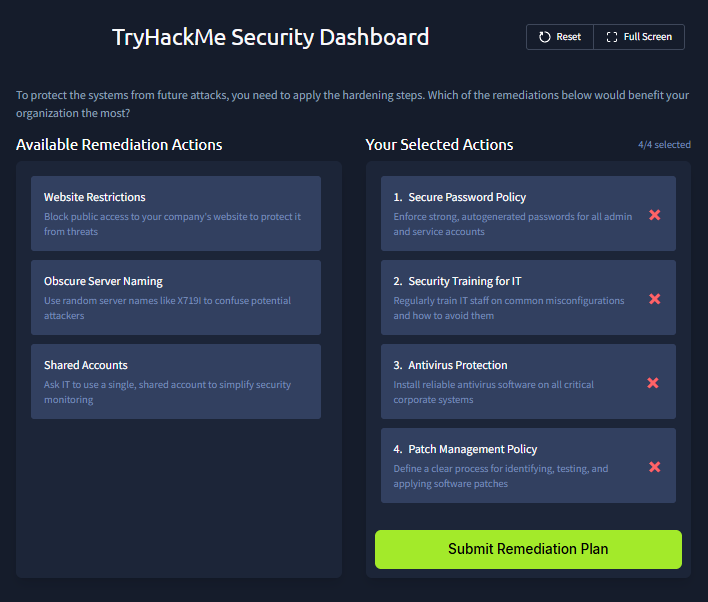

# Systems Attack Vectors

- **Platform:** TryHackMe
- **Difficulty:** Easy
- **Link:** [Systems Attack Vectors](https://tryhackme.com/room/systemsattackvectors)

## Overview

This room focuses on how threat actors attack systems directly, without needing to trick a human. It covers what a system is, human-led attacks, vulnerabilities, supply chain attacks, misconfigurations, and ends with two hands-on challenges where you respond to system incidents and build a remediation plan.

## Task 1 - Introduction

Continuing the SOC role exploration, this room shifts focus from humans to systems as attack vectors. You will learn what systems are, why and how threat groups target them, and what you can do as a SOC analyst to keep your company secure.

Learning objectives:

- Learn the role of a system in a modern digital world
- Explore a variety of real-world attacks targeting systems
- Practice the acquired knowledge in two realistic scenarios

## Task 2 - Definition of System

Back to the castle analogy: even with a trained gatekeeper who can identify phishing and deepfakes, if the lock on the main gate is fragile, the enemy can sneak in while no one is watching. In cyber terms, threat actors can attack insecure systems directly, without the users' knowledge.

Protecting systems is crucial: breaching a user's mailbox via phishing compromises one mailbox, but breaching a mail server gives control over thousands. Each system type has a different value for threat actors:

| Breached System | Attack Value |
|----------------|-------------|
| A personal laptop of a school student | Steal Steam profile and add the PC to a botnet |
| A laptop of the bank's senior IT administrator | Get access to the internal banking systems |
| A mail server of a criminal law company | Dump all mailboxes and blackmail the victim |
| A server at the heart of an industrial network | Encrypt the whole network with ransomware |
| A government website management panel | Damage the website content (defacement / activism) |

### Answers

| # | Question | Answer |
|---|----------|--------|
| 1 | Can cyber attacks happen without victim intervention (Yea/Nay)? | `Yea` |
| 2 | Can a breach of just a single system lead to disastrous consequences (Yea/Nay)? | `Yea` |

## Task 3 - Attacks on Systems

In most serious attacks, the first goal is to gain **access** to the target system. What happens next depends on the attacker's motivation: stealing data, deploying ransomware, or even destroying information. Nearly all attacks begin the same way.

### Human-Led Attacks

System users are often those who start the attack: inserting a malicious USB found on a street, downloading malware from pirated resources, or reusing a weak password everywhere. 81% of breaches involve stolen or breached passwords. A RubberDucky USB device can run malware as soon as you plug it in.

### Vulnerabilities

Every piece of software can have security flaws. In 2024, over 40,000 software vulnerabilities were published and more than 300 were actively exploited in major attacks. IT administrators often increase the risks by setting weak passwords and allowing unrestricted access.

### Supply Chain

Your PC has hundreds of apps, each depending on thousands of libraries. If threat actors breach one of the apps or libraries and push a malicious update, all users will be compromised. This is called a **supply chain attack**. The most famous examples are the SolarWinds and 3CX breaches which affected thousands of companies. Even TryHackMe once fell victim to a supply chain in Lottie Player, a library used for room animations.

### Answers

| # | Question | Answer |
|---|----------|--------|
| 1 | What is the term for a security flaw that can be exploited to breach a system? | `Vulnerability` |
| 2 | What is the name of the attack when malware comes from a trusted app or library? | `Supply Chain` |

## Task 4 - Vulnerabilities

### Software Vulnerabilities

Every piece of software has flaws, and some take years to be discovered. For example, Shellshock, a major Linux vulnerability, existed since 1992 but wasn't found until 2014. In the worst case, attackers discover the vulnerability before anyone else. This is known as a **zero-day**, and only your SOC skills can determine whether it gets detected in time.

Once a vulnerability is made public, it is assigned a **CVE** (Common Vulnerabilities and Exposures) number. From that moment, it's a race: attackers develop exploits while defenders rush to update their systems. Notable CVEs include:

- **EternalBlue** (CVE-2017-0144): A critical SMB vulnerability
- **PrintNightmare** (CVE-2021-34527): A critical flaw in Print Spooler
- **Follina** (CVE-2022-30190): A critical MS Office flaw

### Responding to Vulnerabilities

The answer to a CVE is always a **patch**, an update supplied by the software vendor. For zero-days, you'll have to wait for a patch, vigilantly monitor for exploitation traces, and try to survive the stressful period. In the meantime, you can:

- Restrict access to the system to only trusted IPs
- Apply temporary measures provided by the vendor
- Block known attack patterns on IPS or WAF

### Answers

| # | Question | Answer |
|---|----------|--------|
| 1 | What is the CVE for the critical SharePoint vulnerability dubbed "ToolShell"? | `CVE-2025-53770` |
| 2 | How would you respond to a detected vulnerability on your system? | `Patch` |

## Task 5 - Misconfigurations

A misconfiguration isn't a bug in the software but a mistake in how the system was set up, often by the IT team. These errors happen frequently, usually to make things simpler, like using "1111" instead of a long password. Real-world examples include:

- "123456" password exposed chats for 64 million McDonald's job applications
- A misconfigured AWS cloud resulted in a breach of 106 million bank customers
- Improperly configured smart fridges silently used in full-scale botnet attacks

A common scenario is when the IT department unknowingly introduces new flaws: installing a database, setting a weak password, and disabling the firewall for convenience, creating both a weak password and unrestricted access misconfiguration.

### Responding to Misconfigurations

Misconfigurations do not require a software update, just a better setup. As a SOC analyst, you'll often spot them only after threat actors exploit them. However, proactive responses include:

- **Penetration Testing**: Hire ethical hackers who simulate an attack and report on discovered flaws
- **Vulnerability Scans**: Periodically run tools that can detect default passwords or outdated software
- **Configuration Audits**: Manually review the systems to match best practices like CIS benchmarks

### Answers

| # | Question | Answer |
|---|----------|--------|
| 1 | Can a system patch or software update fix the misconfigurations (Yea/Nay)? | `Nay` |
| 2 | Which activity involves an authorized cyber attack to detect the misconfigurations? | `Penetration Testing` |

## Task 6 - Practice

In this lab, you continue your SOC analyst journey on the TryHackMe Security Dashboard. This time you work with the **Systems at Risk** and **Remediation Plan** tabs.

The defense approach combines **Mitigation** and **Detection**: patched software and antivirus solutions handle the first layers, and the SOC team handles the remaining attacks that slip through.

Common mitigation measures for systems:

| Mitigation | Description |
|-----------|-------------|
| Patch Management | Tracking and patching vulnerable systems to reduce the chance of a successful attack |
| Training for IT | Teaching IT staff the risks of misconfigurations so they are less likely to leave systems unprotected |
| Network Protection | Restricting access to trusted people or IP addresses makes systems much harder to breach |
| Antivirus Protection | A good antivirus can stop or at least detect many different attacks |

### Systems at Risk

You review four system alerts and choose the correct response:

1. **HQ-MAIL-02 at Risk**: Exchange mail server affected by CVE-2024-49040. The penetration team breached it and the server is Internet-exposed. **Action**: Ask IT to apply a patch and update Exchange.

2. **Corporate Website at Risk**: Threat actors brute-forced the WordPress admin panel and replaced the main page with malware links and gambling ads. **Action**: Change the admin's password to a more secure one.

3. **Threat Intelligence Alert**: A neighbor company was hit with ransomware from an exploitation of their old Cisco firewall. **Action**: Ensure all corporate firewalls are patched and do not have CVEs.

4. **LPT-01518 at Risk**: A trusted 3D design application on a designer's laptop suddenly starts running malicious CMD commands after a recent update. **Action**: Investigate a supply chain attack coming with the update.

### Remediation Plan

You select the four most effective hardening measures for the organization:

The correct remediation actions are:
1. **Secure Password Policy**: Enforce strong, autogenerated passwords for all admin and service accounts
2. **Security Training for IT**: Regularly train IT staff on common misconfigurations and how to avoid them
3. **Antivirus Protection**: Install reliable antivirus software on all critical corporate systems
4. **Patch Management Policy**: Define a clear process for identifying, testing, and applying software patches

### Answers

| # | Question | Answer |
|---|----------|--------|
| 1 | What flag did you receive after completing the "Systems at Risk" challenge? | `THM{patch_or_reconfigure?}` |
| 2 | What flag did you receive after completing the "Remediation Plan" challenge? | `THM{best_systems_defender!}` |
